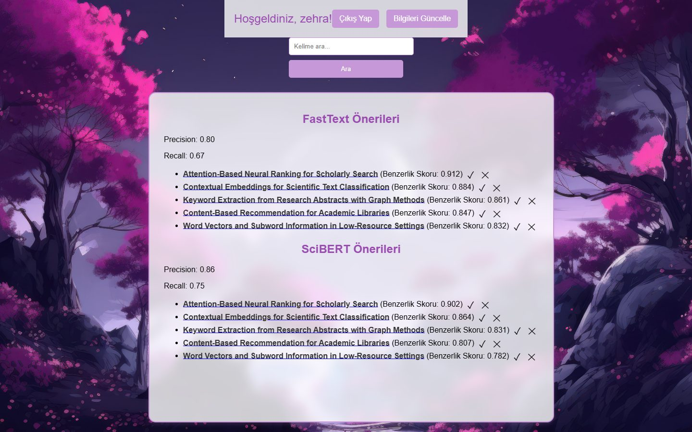
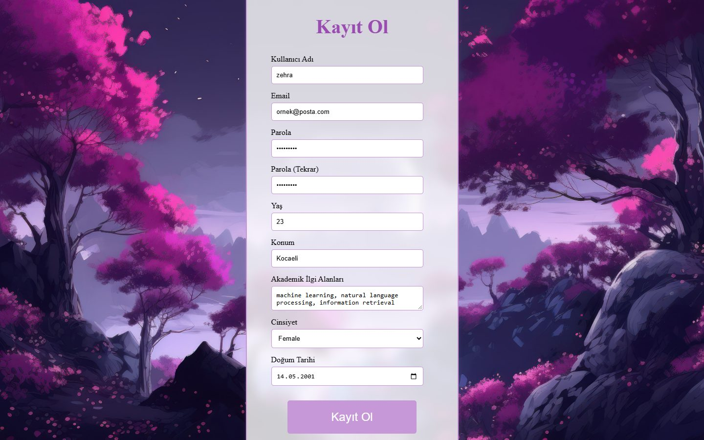

<div align="center">

# Akademik Makale Öneri Sistemi · Academic Article Recommender

**A Django web app that recommends scientific articles from a user's research interests, comparing two
embedding models side by side — FastText and SciBERT — and learning from the user's feedback.**


**English** · [Türkçe](#türkçe)



</div>

## About

When users sign up they describe their academic interests in free text. The app turns that text into two
vectors — an averaged **FastText** word vector and a mean-pooled **SciBERT** embedding — and compares them with
the pre-computed vectors of every article using **cosine similarity**. Each model gets its own list of the top
five articles, so the two approaches can be compared on the same page.

The recommendations improve as the user interacts with them: approving an article (✓) or opening it moves the
user's interest vector toward that article, and removing one (✕) replaces it with the next best match. Per-model
**precision** and **recall** are computed from this feedback and shown live.

## Screenshots

| Welcome | Sign up with research interests |
| :---: | :---: |
|  |  |
| **Log in** | **Article detail** |
|  |  |

> Screenshots were rendered from the project's templates with sample data; article titles are illustrative.

## How it works

```
interests (free text)
   ├─ FastText cc.en.300 ── average of word vectors ───────────┐
   └─ SciBERT ──────────── mean pooling over attention mask ───┤
                                                               ▼
articles in MongoDB (title, abstract, keywords, fasttext_vector, scibert_vector)
                                                               ▼
               cosine similarity → top 5 per model (+1 spare for replacements)
                                                               ▼
   ✓ approve / open article → user vector = (user + article) / 2,  TP += 1
   ✕ remove                 → next best article takes its place
                                                               ▼
                    precision = TP / (TP + FP) · recall = TP / (TP + FN)
```

## Features

- Sign up with age, location, gender, birth date and **free-text research interests**
- Two recommendation lists side by side: **FastText** vs **SciBERT**
- Feedback loop: approve, remove or open an article; recommendations update without a page reload
- Live **precision / recall** per model
- Article detail page with abstract and keywords
- Keyword search over articles
- Profile update; user data is kept in sync with MongoDB

## Tech stack

| | |
| --- | --- |
| Backend | Python, Django 4.2 |
| Data | SQLite (Django auth and profiles), MongoDB (`pymongo`) for articles and user vectors |
| NLP | FastText (`cc.en.300.bin`), SciBERT via Hugging Face Transformers, PyTorch |
| Similarity | NumPy, scikit-learn `cosine_similarity` |
| Frontend | Django templates, HTML, CSS, JavaScript (Fetch API) |

## Getting started

**Requirements:** Python 3.9+, a MongoDB instance (local or Atlas), the FastText English vectors and a SciBERT
model saved locally.

```bash
git clone https://github.com/ZehraAltunok1/Academic-Article-Suggestion-System.git
cd Academic-Article-Suggestion-System
python -m venv venv
venv\Scripts\activate          # macOS / Linux: source venv/bin/activate
pip install django pymongo fasttext transformers torch numpy scikit-learn passlib
```

1. Download the FastText vectors (`cc.en.300.bin`) and a SciBERT model/tokenizer
   (e.g. `allenai/scibert_scivocab_uncased`), then update the paths at the top of `SignUpForm` in
   `yazlab3/veritabani.py`.
2. Replace the `"mongodb client"` placeholders in `yazlab3/views.py`, `yazlab3/besli.py` and
   `yazlab3/veritabani.py` with your MongoDB connection string.
3. Load your articles into the `deneme1` collection of the `yazlab3` database. Each document needs `title`,
   `summary`, `key_content`, `fasttext_vector` and `scibert_vector` (vectors computed with the same models).
4. Set `SECRET_KEY` in `yazlab_projesi/settings.py`, then:

```bash
python manage.py migrate
python manage.py runserver
```

Open <http://127.0.0.1:8000>.

## Project structure

```
Academic-Article-Suggestion-System/
├── yazlab_projesi/        # Settings and root URLs
├── yazlab3/
│   ├── veritabani.py      # Sign-up form, FastText / SciBERT embeddings, MongoDB sync
│   ├── besli.py           # Recommendations, feedback, replacement, search
│   ├── views.py           # Home, sign-up, profile update, article detail
│   ├── models.py          # Profile (interests, vectors, TP / FP / FN counters)
│   ├── templates/         # Pages
│   └── static/img/        # Backgrounds
├── docs/screenshots/      # README images
└── manage.py
```

---

## Türkçe

**Akademik Makale Öneri Sistemi**, kullanıcının araştırma ilgi alanlarına göre bilimsel makale öneren bir Django
web uygulamasıdır. İki gömme (embedding) modeli yan yana karşılaştırılır: **FastText** ve **SciBERT**.

### Nasıl çalışır?

- Kayıt sırasında kullanıcı akademik ilgi alanlarını serbest metinle yazar.
- Bu metin iki vektöre dönüştürülür: FastText kelime vektörlerinin ortalaması ve SciBERT'in dikkat maskesiyle
  ortalanmış çıktısı.
- Vektörler, MongoDB'deki makalelerin önceden hesaplanmış vektörleriyle **kosinüs benzerliği** ile
  karşılaştırılır; her model için en benzer beş makale ayrı listelenir.
- Kullanıcı bir makaleyi onaylarsa (✓) ya da açarsa ilgi vektörü o makaleye doğru güncellenir; kaldırırsa (✕)
  yerine sıradaki en iyi makale gelir.
- Geri bildirimlerden her model için **precision** ve **recall** hesaplanıp sayfada canlı gösterilir.

### Özellikler

- Yaş, konum, cinsiyet, doğum tarihi ve serbest metin ilgi alanlarıyla kayıt
- FastText ve SciBERT önerileri yan yana
- Onayla / kaldır / aç ile geri bildirim; öneriler sayfa yenilenmeden güncellenir
- Model başına canlı precision / recall
- Makale detayı (özet ve anahtar kelimeler), anahtar kelimeyle arama, profil güncelleme

### Kullanılan teknolojiler

Python, Django 4.2, SQLite, MongoDB, FastText, SciBERT (Hugging Face Transformers), PyTorch, NumPy,
scikit-learn, HTML, CSS, JavaScript.

### Kurulum

Kurulum adımları yukarıdaki [Getting started](#getting-started) bölümündedir: model dosyalarının yolları
`yazlab3/veritabani.py` içinde, MongoDB bağlantı adresi ise `"mongodb client"` yazan yerlerde güncellenmelidir.

> Ekran görüntüleri projenin şablonlarından örnek verilerle oluşturulmuştur; makale başlıkları temsilîdir.

<div align="center">

Zehra Altunok · [GitHub](https://github.com/ZehraAltunok1)

</div>
